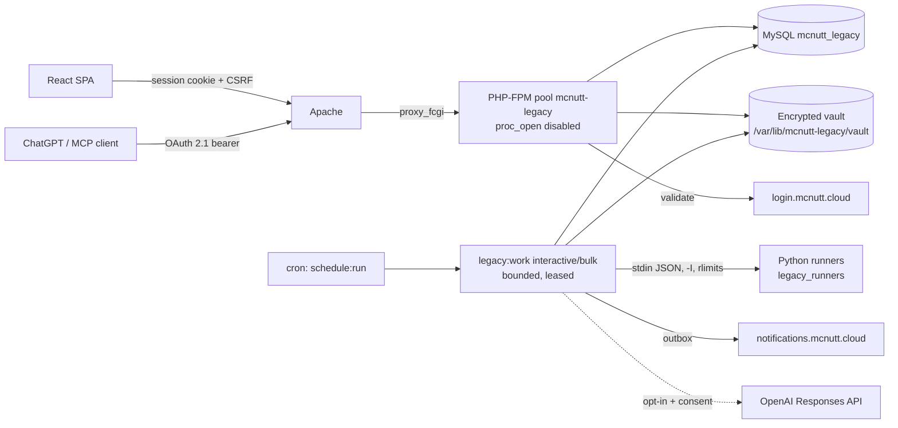

# Architecture

## Context

McNutt Legacy runs on the shared McNutt Cloud Ubuntu host next to other apps (invoices, journey, finance). It reuses
McNutt Cloud SSO (`login.mcnutt.cloud`) for identity and `notifications.mcnutt.cloud` for email, but owns its data,
user account, PHP-FPM pool, database and storage.

## Key decisions

| # | Decision | Why |
| --- | --- | --- |
| 1 | **Scopes × domains × actions grants**, deny by default; roles never grant data | Spouses, adult children, advisors and trustees need overlapping but different views. Admins manage people, not data. |
| 2 | **Composite `(workspace_id, id)` FKs** on every reference | Cross-workspace linkage is impossible at the database level, not just in code. |
| 3 | **Registry-driven resources** (`app/Resources/Registry.php`) | One definition yields validation, CRUD, redaction, filters, OpenAPI and TypeScript types for ~70 record types. |
| 4 | **Leased compute jobs run by cron** (no daemons, no queue server) | Shared host: no supervisor. Leases + attempts + backoff make crashes safe; per-workspace concurrency caps protect siblings. |
| 5 | **Python calculators as pure stdin/stdout programs** | Decimal tax math, numpy Monte Carlo; isolated (`-I`, minimal env, rlimits, job-dir confinement); output validated in PHP before a transactional commit. |
| 6 | **Versioned, hashed tax rule packs with named approval** | A run can only be *calculated* when every rule is sourced and approved; otherwise it is an *estimate*. |
| 7 | **Envelope encryption for the vault** (XChaCha20-Poly1305 secretstream per file, DEK wrapped by `VAULT_ROOT_KEY`) | Key held outside DB and backups; rotation via `legacy:vault-rewrap`. |
| 8 | **Transactional outbox** | Notifications/side effects are emitted only after commit and retried idempotently; ambiguous sends are `delivery_unknown`, never "sent". |
| 9 | **Hash-chained audit log** | Tamper-evident trail per workspace; metadata sanitized (no tokens, amounts, identifiers). |
| 10 | **MCP over Streamable HTTP with an OAuth 2.1 facade** | ChatGPT connector with PKCE, DCR, audience-bound rotating tokens; tools trimmed to granted scopes and member grants. |
| 11 | **Immutable releases + atomic symlink** | Fast rollback; app user cannot modify code; migrations additive. |

## Request lifecycle (API)

1. `EnsureCentralAuth` — local session bound to a verified McNutt Cloud identity, revalidated every 5 minutes (fail closed).
2. `throttle:api`, `Idempotency` (key bound to principal + method + path + body hash; replay returns stored response).
3. `ResolveWorkspace` — active membership → `AccessContext` (user, workspace, membership, grants, token limits).
4. Controller → service; every query uses `AccessContext::constrain($q, domain, action, yearColumn)`.
5. Errors → `ApiError` JSON with correlation id; security headers + strict CSP on every response.

## Data model (high level)

- **Platform:** users, workspaces, memberships, scopes, scope_stewards, access_grants, consents, audit_events, outbox_events,
  idempotency_keys, compute_jobs, notifications/deliveries/preferences, oauth_* , download_tokens, export_grants.
- **Household:** persons, relationships, households, ownership_interests (effective-dated fractions), legal_entities, trusts, roles.
- **Financial:** accounts, transactions (fingerprinted), balance_snapshots, holdings, lots, instruments, valuations, liabilities,
  import profiles/batches/rows, books/journal (double entry), annual_snapshots (year close).
- **Earnings/tax:** employments, payroll_snapshots, equity grants/tranches/events, tax units/documents/inputs/payments/
  carryforwards/runs/strategies, tax_rule_packs.
- **Planning/estate/insurance/governance:** plans, scenarios, runs; estate documents/scenarios/runs, beneficiary designations;
  policies, coverages, claims, shopping cases/quotes; decisions, meetings, goals, tasks, emergency binders, break-glass.
- **Vault:** documents, document_versions (ciphertext path, wrapped DEK, sha256, scan status), document_extractions, review_items.

## Calculators (`runners/legacy_runners`)

| Job type | Module | Notes |
| --- | --- | --- |
| `tax.compute`, `tax.strategies` | `tax/engine.py`, `federal.py`, `nj.py`, `rental.py`, `strategies.py` | Line map + trace; §280A/§469 rental classification; strategies re-run the full engine |
| `plan.project/montecarlo/stress` | `planning/projection.py`, `ss.py` | Vectorized annual engine; tax-aware withdrawals; PCG64 seeded; sensitivity |
| `debt.compare`, `debt.amortize` | `debt.py` | Actual due dates, per-period rounding; avalanche/snowball/refi/invest-instead |
| `estate.distribute` | `estate.py` | Title/beneficiary first, then will/trust; federal estate + NJ inheritance; liquidity |
| `equity.model` | `equity.py` | Vesting state, scenario values, waterfall |
| `import.normalize` | `imports.py` | Monarch/Snowball/generic CSV, schema drift detection, fingerprints |
| `document.extract` | `documents.py` | PDF text layer fallback; OpenAI only with opt-in + consent |

## Frontend

React 19 SPA served by Laravel's shell view; routes under `/w/:workspace/*`. Data via TanStack Query keyed by workspace id
(switching workspace clears cache). Every chart has a table alternative; forms are label-associated; dialogs use native
`<dialog>`. Global step-up prompt appears on `step_up_required`.
